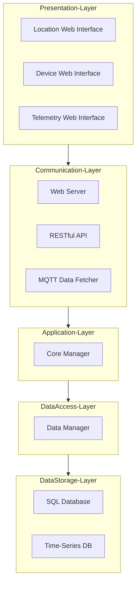
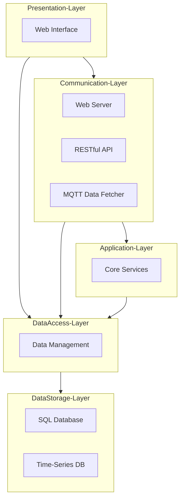
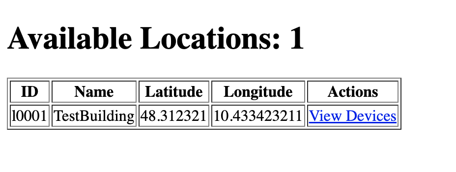
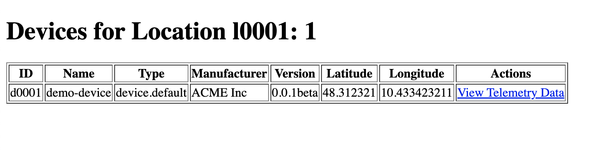
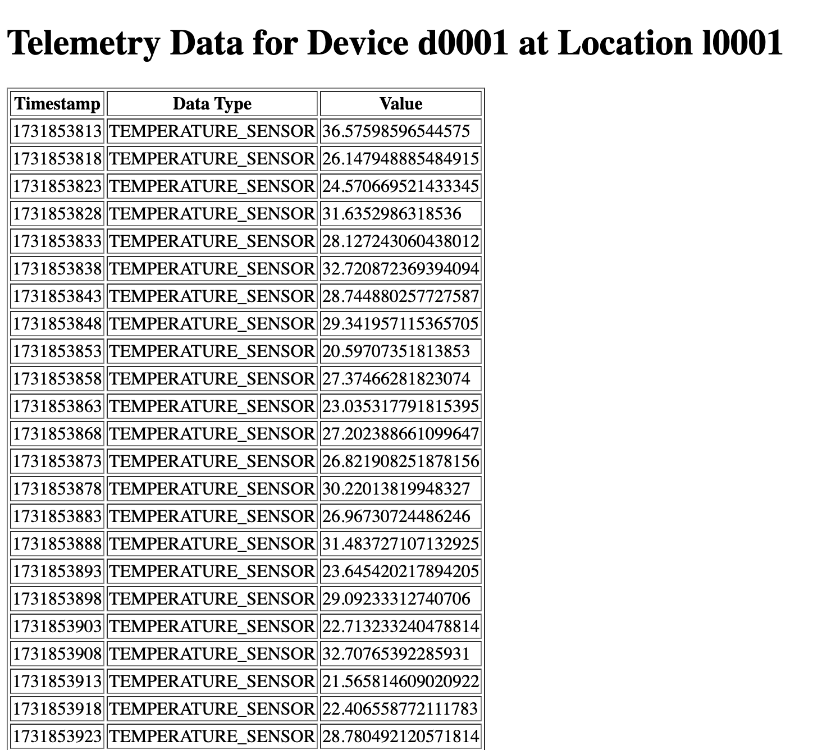

# IoT Monolithic Software Architecture Playground

This project is designed as an IoT Monolithic Software Architecture Playground, 
demonstrating a structured approach to building an IoT application using an 
**n-Tier** architecture. The architecture is divided into five distinct layers, 
each responsible for specific functionalities, ensuring modularity, 
scalability, and maintainability.

Reference Libraries: Flask & Flask-RESTful (Web Server and RESTful API) - Paho MQTT 2.x (MQTT Data Fetcher) - https://github.com/eclipse/paho.mqtt.python

## Setup

The project is managed with [uv](https://docs.astral.sh/uv/). Dependencies are declared in `pyproject.toml`,
locked in `uv.lock`, and the Python version (3.12) is pinned in `.python-version`.

- Dependencies: `flask` and `flask-restful` (Web Server and RESTful API), `paho-mqtt` 2.x (MQTT Data Fetcher and
  MQTT testers), `pyyaml` (configuration files) and `requests` (HTTP testers)

Install uv (if needed) following the [official instructions](https://docs.astral.sh/uv/getting-started/installation/), e.g.:

```bash
curl -LsSf https://astral.sh/uv/install.sh | sh
```

Then, from the project root, create the virtual environment (`.venv`) and install all the dependencies with:

```bash
uv sync
```

uv automatically downloads the required Python version if it is not available on your machine.
The command also installs the `iot_monolithic_playground` package (in `src/`) in editable mode, together with a
dedicated command for the application and for each tester (see [Running the Application](#running-the-application)).

In PyCharm, you can select the existing `.venv` interpreter or add a new "uv" interpreter from the interpreter settings.

### Using pip (alternative)

The `requirements.txt` file is **generated** from `uv.lock` and is kept only for pip-based workflows:

```bash
pip install -r requirements.txt
```

Do not edit it manually. After changing the dependencies, regenerate it with:

```bash
uv export --no-hashes --no-dev -o requirements.txt
```

### MQTT Broker

The MQTT Data Fetcher and the MQTT testers require a running MQTT Broker, configured in `config/mqtt_fetcher_conf.yaml`
(default: `127.0.0.1:1883` without authentication). A local [Eclipse Mosquitto](https://mosquitto.org/) broker can be
installed natively or started with Docker:

```bash
docker run -it --rm -p 1883:1883 eclipse-mosquitto:2 mosquitto -c /mosquitto-no-auth.conf
```

The application starts even if the broker is not available yet: the MQTT Data Fetcher keeps retrying the connection
in the background, while the Web Server and the RESTful API are immediately available.

## n-Tier Architecture Overview

Designing an n-Tier Software Architecture for an Internet of Things (IoT) 
application involves separating concerns into different layers, each responsible for specific aspects of the system. 
Below is a proposed architecture that meets the specified requirements for the target Playground and Example:

The idea of the architecture (using the framework [https://mermaid.js.org/](https://mermaid.js.org/)) is the following: 



## System Architecture Description

The system architecture is structured into five distinct layers, each responsible for specific functionalities, 
ensuring a modular and scalable design for the Internet of Things (IoT) application. The layers are as follows:

### 1. Presentation Layer
- **Web Interface**: This component provides the user interface for the system, allowing users to interact with the application through a web browser. It displays device information, telemetry data, and other relevant details.

### 2. Communication Layer
- **Web Server**: Handles HTTP requests from the Web Interface and other clients. It serves static and dynamic content and manages incoming and outgoing web traffic.
- **RESTful API**: Exposes system functionalities and data through RESTful endpoints, allowing external applications to interact with the system programmatically.
- **MQTT Data Fetcher**: Manages MQTT communication, subscribing to MQTT topics to collect device information and telemetry data from various devices.

### 3. Application Layer
- **Core Services**: Implements the business logic of the application. It processes data received from the Communication Layer, executes core application functionalities, and manages the flow of information between different layers.

### 4. Data Access Layer
- **Data Management**: Provides an abstraction layer for data access. It handles CRUD operations (Create, Read, Update, Delete) and ensures data integrity and consistency when interacting with the underlying storage systems.

### 5. Data Storage Layer
- **SQL Database**: Stores structured data such as device inventory and configuration settings in a relational database.
- **Time-Series DB**: Stores time-series data, such as telemetry data from IoT devices, which is optimized for handling large volumes of time-stamped information.
- **Note**: In this example the Data Storage Layer is not implemented and the Data Access Layer interacts with the data directly through an in memory data structure.

This architecture ensures a clear separation of concerns, making the system modular, scalable, and easier to maintain. 
Each layer focuses on specific responsibilities, facilitating independent development, testing, and scaling of different parts of the system.

This example of an n-Tier architecture separates concerns into distinct layers, improving maintainability, scalability, and flexibility. 
Each layer can be developed, deployed, and scaled independently, allowing for a robust and flexible IoT system.

## Decision to Implement a Closed Layer Approach

### Closed Layer Architecture

In a closed layer architecture, each layer can only interact with the layer directly below it. This ensures a clear separation of concerns and encapsulation, making the system modular and easier to maintain.

- **Presentation Layer** can only communicate with the **Communication Layer**.
- **Communication Layer** can only communicate with the **Application Layer**.
- **Application Layer** can only communicate with the **Data Access Layer**.
- **Data Access Layer** can only communicate with the **Data Storage Layer**.

This approach adheres to the principle of **layers of isolation**, which means:
- Changes in one layer do not affect other layers.
- Layers remain independent with well-defined interfaces.
- Each layer has minimal knowledge of the inner workings of other layers.

#### Advantages of Closed Layer Architecture

- **Encapsulation**: Each layer is isolated, making it easier to manage and update.
- **Maintainability**: Changes in one layer do not cascade to others, reducing the risk of introducing bugs.
- **Scalability**: Individual layers can be scaled independently based on load requirements.

#### An Example of Open Layer Architecture

In an open layer architecture, any layer can bypass intermediate
layers to directly interact with a lower layer. 
For instance, the Presentation Layer 
can directly access the Data Access Layer without going through the Application Layer.

##### Potential Issues with Open Layer Architecture
 
- Tight Coupling: Layers become tightly coupled, making the system more brittle and harder to maintain.
- Increased Complexity: Direct interactions between non-adjacent layers can introduce complex dependencies.
- Difficult to Isolate: Changes in one layer can have cascading effects on multiple layers, making it difficult to isolate and fix issues.

Example of the same architecture with an open layer approach:



The choice between open and closed layers depends on the specific needs 
of the application. 
Closed layers provide better encapsulation and maintainability, 
while open layers offer flexibility at the cost of 
increased complexity and tighter coupling. For most applications, 
especially those requiring high maintainability 
and scalability, a closed layer architecture is preferred.

## File Structure Overview

The project follows the `src` layout: all the code is in the `iot_monolithic_playground` package, organized in one
sub-package for each layer of the n-Tier architecture.

```
iot-monolithic-arch-playground/
├── pyproject.toml                      # Project metadata, dependencies and entry points
├── uv.lock                             # Locked dependency versions (managed by uv)
├── requirements.txt                    # Generated from uv.lock for pip users
├── config/                             # Configuration files of the modules
│   ├── api_conf.yaml                   # RESTful API Server (prefix, host, port)
│   ├── web_conf.yaml                   # Web Server (host, port)
│   └── mqtt_fetcher_conf.yaml          # MQTT Data Fetcher (broker, client id, credentials, topic)
└── src/iot_monolithic_playground/
    ├── main.py                         # Entry point: creates the layers and starts the modules
    ├── presentation/                   # Presentation Layer: HTML templates
    ├── communication/                  # Communication Layer
    │   ├── web/                        # Web Server (Flask)
    │   ├── api/                        # RESTful API (Flask-RESTful): server, resources and DTOs
    │   └── mqtt/                       # MQTT Data Fetcher (Paho MQTT) and its DTO
    ├── application/                    # Application Layer: Core Manager and domain models
    ├── data/                           # Data Access Layer: Data Manager (in-memory storage)
    ├── config/                         # ConfigLoader (reads the YAML files of config/)
    └── tester/                         # External clients to test the application
        ├── http/                       # HTTP clients of the RESTful API
        └── mqtt/                       # Emulated MQTT devices and telemetry consumer
```

### Presentation Layer

The `presentation` package contains the web interface components. They are simple HTML templates (rendered by Flask
with Jinja2), while in a real-world scenario this layer would contain a complete web application:

- `locations.html`: Displays the registered locations
- `devices.html`: Lists the registered devices of a target location and their details
- `telemetry.html`: Shows the telemetry data of a selected device

### Communication Layer

The `communication` package includes the web server, the RESTful API and the MQTT data fetcher. These components handle
incoming requests, expose the system functionalities and collect data from IoT devices. Each one runs in a dedicated
thread, so the three modules work in parallel inside the same process:

- `web`: Web Server implemented with Flask
  - `web_server.py`: renders the templates of the Presentation Layer with the data provided by the Application Layer
- `api`: RESTful API implemented with Flask-RESTful
  - `rest_api_server.py`: defines the RESTful API endpoints
  - `resources`: Flask-RESTful resources (locations, location, devices, device)
  - `dto`: Data Transfer Objects (DTOs) of the requests and responses
- `mqtt`: MQTT communication based on the Paho MQTT library (2.x)
  - `mqtt_data_fetcher.py`: subscribes to the telemetry topic of the devices and forwards the data to the Application Layer
  - `dto`: Data Transfer Object (DTO) of the telemetry messages

The Communication Layer converts the received DTOs (e.g., the `TelemetryMessage` received through MQTT) into the
domain models of the Application Layer (e.g., `TelemetryModel`) before calling the Core Manager. In this way the lower
layers never depend on the formats used by the Communication Layer, as required by the closed layer approach.

### Application Layer

The `application` package contains the business logic:

- `core_manager.py`: the `CoreManager`, the only entry point used by the Communication Layer. It delegates the data
  operations to the Data Access Layer and implements the application logic, e.g., the telemetry of a device is stored
  only if the device is registered;
- `model`: the domain models (`LocationModel`, `DeviceModel`, `TelemetryModel`).

### Data Access Layer

The `data` package contains the `DataManager`, that stores locations, devices and telemetry data. In this example the
data is kept **in memory** (it is lost when the application stops) and the Data Storage Layer is not implemented.

### Configuration

Each module of the Communication Layer reads its parameters from a YAML file of the `config/` folder through the
`ConfigLoader` class. A relative path (e.g., `config/api_conf.yaml`) is searched in the current working directory and
then in the project root, so the application can be started from any folder. Parameters missing from a file keep their
default values.

| File                     | Parameters                                                                   |
|--------------------------|------------------------------------------------------------------------------|
| `api_conf.yaml`          | `rest.api_prefix`, `rest.host`, `rest.port` (default `7070`)                  |
| `web_conf.yaml`          | `web.host`, `web.port` (default `7071`)                                       |
| `mqtt_fetcher_conf.yaml` | `broker_ip`, `broker_port`, `client_id`, `username`, `password`, `target_telemetry_topic` |

### Type Hints

The code uses Python **type hints** (Python >= 3.10 syntax). To check the code with [mypy](https://mypy.readthedocs.io/) run:

```bash
uv run --with mypy mypy src/iot_monolithic_playground --ignore-missing-imports
```

## Running the Application

Each process is exposed as a command declared in the `[project.scripts]` section of `pyproject.toml`:

| Command                   | Module                                                       | Description                                      |
|---------------------------|--------------------------------------------------------------|--------------------------------------------------|
| `iot-monolith`            | `iot_monolithic_playground.main`                             | The monolithic application                       |
| `mqtt-device-producer`    | `iot_monolithic_playground.tester.mqtt.json_producer`        | Emulated device publishing temperature telemetry |
| `mqtt-telemetry-consumer` | `iot_monolithic_playground.tester.mqtt.json_consumer`        | Consumer printing the telemetry of all devices   |
| `create-location`         | `iot_monolithic_playground.tester.http.create_location`      | Create a new location through the RESTful API    |
| `create-device`           | `iot_monolithic_playground.tester.http.create_device`        | Create a new device through the RESTful API      |

With the MQTT Broker running, from the project root start the application:

```bash
uv run iot-monolith
```

The application creates the layers from the bottom to the top (Data Manager, Core Manager and the three modules of the
Communication Layer), starts the modules in their threads and runs until it is stopped with `CTRL+C`, which shuts down
the MQTT Data Fetcher, the Web Server and the RESTful API.

The data manager is initialized with a demo location `l0001` and a demo device `d0001`. To simulate the device, in
another terminal start an emulated device publishing on `device/d0001/temperature`:

```bash
uv run mqtt-device-producer
```

The telemetry of a device is stored only if the device is registered. To work with a new device, create it through
the RESTful API and then start its emulated device:

```bash
uv run create-location l0002
uv run create-device test_device_1 l0002
uv run mqtt-device-producer test_device_1
```

The `mqtt-telemetry-consumer` command prints all the telemetry flowing through the broker, independently of the application.

The RESTful API is available at `http://localhost:7070/api/iot/inventory`, e.g.:

```bash
curl http://localhost:7070/api/iot/inventory/location
curl http://localhost:7070/api/iot/inventory/location/l0001/device
curl "http://localhost:7070/api/iot/inventory/location/l0001/device?type=device.default"
```

The web interface of the Presentation Layer is available at the following URLs:

- [http://localhost:7071/locations](http://localhost:7071/locations): registered locations
- [http://localhost:7071/location/l0001/devices](http://localhost:7071/location/l0001/devices): devices of the location `l0001`
- [http://localhost:7071/location/l0001/device/d0001/telemetry](http://localhost:7071/location/l0001/device/d0001/telemetry): telemetry of the device `d0001`

**Location List**



**Device List**



**Telemetry Data List**



### Use MQTT Broker with Credentials

The default configuration works with a local MQTT Broker without authentication. To use a broker that requires
credentials, set `username` and `password` in `config/mqtt_fetcher_conf.yaml`: they are used both by the MQTT Data
Fetcher and by the MQTT testers, that read the broker parameters from the same file.

If the broker also restricts the topics that each account can use (ACL), update the topic structure accordingly:
the subscription filter `target_telemetry_topic` of the fetcher and the `topic_template` variable of the
`json_producer.py` tester.
